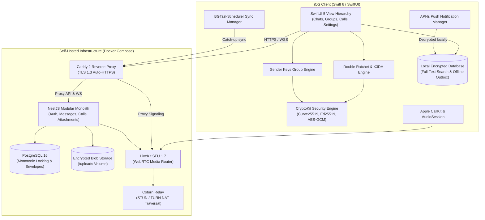

# Mini Telegram (iOS & Self-Hosted Modular Monolith)

[](https://swift.org)
[](https://developer.apple.com/ios/)
[](https://nestjs.com)
[](https://www.postgresql.org)
[](https://livekit.io)
[](https://signal.org/docs/)
[](LICENSE)

**Mini Telegram** is an end-to-end encrypted (E2EE), private, invite-only team communication system natively designed for iPhone (Swift 6, SwiftUI, CryptoKit) and powered by a self-hosted modular monolith backend (NestJS, TypeScript, PostgreSQL 16, Socket.IO WebSockets, LiveKit SFU WebRTC).

Engineered specifically for private teams and research groups (10–50 users) who demand complete infrastructure sovereignty, mathematical zero-knowledge privacy, and zero reliance on third-party cloud surveillance.

---

## 🏗️ System Architecture



---

## 🔒 Cryptographic Model & Zero-Knowledge Invariants

| Protocol / Layer | Implementation Primitive | Cryptographic Guarantee | Zero-Knowledge Invariant |
| :--- | :--- | :--- | :--- |
| **1:1 Direct Chats** | Signal Double Ratchet + X3DH | Curve25519 DH, Ed25519 Signatures, HKDF-SHA256, AES-256-GCM | Server routes only opaque ciphertext envelopes; server never possesses DH private keys or ratchet state. |
| **Group Messaging** | Sender Keys Protocol | 256-bit Chain Keys, AES-256-GCM, SHA-256 KDF | Group keys are shared exclusively over pairwise Double Ratchet channels. Evicted members trigger automatic key rotation. |
| **File Attachments** | Client-Side AES-256-GCM | Ephemeral 256-bit Key, 96-bit Nonce, SHA-256 Integrity Tag | Files are encrypted before upload. The server only sees encrypted binary chunks; symmetric keys are transmitted inside E2EE messages. |
| **Audio/Video Calls** | SFrame / FrameCryptor E2EE | HKDF-SHA256 from Shared Secret, AES-128/256-GCM Media Frames | LiveKit SFU acts purely as an encrypted packet forwarder. SFU cannot decode audio or video streams. 4-emoji visual fingerprint verifies call participants. |
| **Push Notifications** | Zero-Knowledge APNs | iOS Localization Keys (`loc-key`) + Encrypted Payload Envelopes | Apple APNs servers receive zero plaintext message text, zero sender usernames, and zero keys. Decryption occurs strictly on-device in background. |
| **Local Storage** | Apple Keychain & Secure Enclave | `kSecAttrAccessibleAfterFirstUnlockThisDeviceOnly` + Biometric Lock | Keys never leave the physical iOS device and are excluded from unencrypted iCloud/iTunes backups. |

---

## 🚀 Key Feature Matrix (Phases 0 – 9)

- ✅ **Strict Invite-Only Onboarding**: Public registration is physically disabled. Cryptographically secure 32-character single-use invite tokens issued by Super-Admin with role assignment (`superadmin`, `member`) and expiration dates.
- ✅ **Multi-Device Registration & Revocation**: Ed25519 identity keys, Curve25519 signed prekeys, and 50 one-time prekeys (OPKs) per device. Remote device revocation with immediate JWT session termination.
- ✅ **Linear Monotonic Sequencing**: Server enforces atomic monotonic sequence allocation (`UPDATE ... SET last_sequence_id = last_sequence_id + 1 RETURNING last_sequence_id`) preventing out-of-order message injection or gaps.
- ✅ **Offline Persistence & Full-Text Search**: File-backed encrypted local database with instant full-text search across decrypted text, message deduplication, and unread badges.
- ✅ **Interactive Rich Messaging**: Quoted replies, interactive multi-emoji reactions ribbons, delivery/read tick indicators (sending, sent, delivered, read), and live typing status broadcast.
- ✅ **Multi-Party Group Management**: Owner, Admin, Member, and Read-Only roles. Cryptographic eviction re-key notifications broadcast across remaining members on eviction.
- ✅ **Voice Notes & Live Waveforms**: Native AAC audio recording with live decibel waveform metering, interactive playback scrubber, and dedicated Telegram-style voice bubbles.
- ✅ **WebRTC Audio & Video Calling**: LiveKit SFU integration, SFrame end-to-end media encryption, 4-emoji visual security fingerprint, Picture-in-Picture camera preview, and full CallKit lock-screen calling.
- ✅ **Apple CallKit Integration**: Native incoming call screen, lock-screen answering, hardware mute synchronization, and `AVAudioSession` voice chat audio routing.
- ✅ **Privacy-Preserving Push Notifications**: Silent APNs wake-up payloads with background decryption via `PushNotificationManager` and local notification display.
- ✅ **Background Catch-Up Synchronization**: Apple `BGTaskScheduler` background task registration (`com.minitelegram.background-sync`) for periodic catch-up sync while app is suspended.
- ✅ **First-Class Bilingual Localization**: Complete native English (`en`) and Khmer (`km`) translations with instant dynamic runtime language switching without restarting the app.
- ✅ **Operational Readiness & Disaster Recovery**: Turnkey Docker Compose production profile (`docker-compose.prod.yml`), automated backup script (`backup.sh`), verified restore drill (`restore.sh`), automated test suite (`test_backup_restore.sh`), and operations runbook (`OPERATIONS.md`).

---

## 📦 Directory Structure

```
.
├── docs/                                # Technical specifications and architecture guides
│   ├── ARCHITECTURE.md                  # MVVM topology, state management, dependency injection
│   ├── SECURITY.md                      # Threat modeling, key storage, and attack mitigations
│   ├── ENCRYPTION.md                    # Signal Double Ratchet, X3DH, Sender Keys specifications
│   ├── CALLING.md                       # WebRTC, LiveKit SFU, SFrame FrameCryptor, CallKit
│   ├── DATABASE.md                      # PostgreSQL schema, migrations, monotonic sequence locking
│   ├── API.md                           # REST API endpoints and Socket.IO realtime event protocols
│   ├── DEPLOYMENT.md                    # Home server setup, port forwarding, and CGNAT workarounds
│   ├── BACKUP-RECOVERY.md               # Backup strategies, encryption, and disaster recovery
│   ├── DEVELOPMENT.md                   # Local setup, testing instructions, and developer guides
│   └── OPERATIONS.md                    # Production operations manual, runbooks, and incident response
├── infrastructure/                      # Self-hosted infrastructure orchestration
│   ├── docker-compose.yml               # Development stack (PostgreSQL, Caddy, LiveKit, Coturn)
│   ├── docker-compose.prod.yml          # Production stack (Resource limits, logging quotas, healthchecks)
│   ├── livekit.yaml                     # LiveKit SFU configuration
│   ├── coturn/turnserver.conf           # Coturn STUN/TURN configuration
│   └── reverse-proxy/Caddyfile          # Caddy 2 reverse proxy with strict security headers
├── ios/                                 # Native iOS Client (Swift 6, SwiftUI, iOS 17+)
│   ├── MiniTelegram.xcodeproj           # Standard Xcode project (generated via XcodeGen)
│   ├── MiniTelegram/
│   │   ├── App/                         # App lifecycle, AppState, AppContainer DI container
│   │   ├── Core/
│   │   │   ├── Security/                # CryptoIdentity, DoubleRatchet, X3DH, SenderKeys, Keychain
│   │   │   ├── Database/                # LocalDatabaseManager (SQLite persistence, FTS, outbox)
│   │   │   ├── Network/                 # APIClient, RealtimeService (WebSocket / Socket.IO)
│   │   │   ├── Media/                   # AudioRecorderManager, AudioPlayerManager, AttachmentManager
│   │   │   ├── Calling/                 # CallKitManager, FrameCryptorManager (SFrame E2EE)
│   │   │   ├── Notifications/           # PushNotificationManager (APNs Zero-Knowledge Decryption)
│   │   │   ├── Sync/                    # BackgroundSyncManager (Apple BGTaskScheduler)
│   │   │   └── Localization/            # LocalizationManager (English & Khmer runtime switching)
│   │   ├── Features/                    # SwiftUI Feature Modules (Auth, Chats, Groups, Calls, Settings)
│   │   ├── DesignSystem/                # Tokens (Colors, Spacing, Typography) and Reusable Components
│   │   └── Resources/                   # Localization strings (en, km) and Assets
│   └── Tests/                           # Comprehensive iOS Unit Test Suite (35 Passing Tests)
├── scripts/                             # Operational & Automation Shell Scripts
│   ├── backup.sh                        # Automated DB & attachment backup with SHA-256 and AES-256
│   ├── restore.sh                       # Verified disaster recovery and data restoration
│   ├── test_backup_restore.sh           # Automated 5-step DR drill test suite
│   └── cron_backup.sh                   # Cron automation wrapper with timestamped logging
└── server/                              # Modular Monolith Backend (NestJS, TypeScript)
    ├── Dockerfile                       # Hardened multi-stage Dockerfile (Alpine, non-root, tini)
    ├── src/
    │   ├── auth/                        # Invitations, Passwords, JWT Tokens, Device Registration
    │   ├── conversations/               # 1:1 and Group conversations, member role management
    │   ├── messages/                    # Monotonic sequence ordering, deduplication, receipts
    │   ├── realtime/                    # Socket.IO Gateway (realtime events, presence, typing)
    │   ├── attachments/                 # Encrypted blob upload/download routing
    │   ├── calls/                       # LiveKit token generation and call session tracking
    │   ├── notifications/               # APNs device registration and zero-knowledge push formatting
    │   ├── database/                    # PostgreSQL service, connection pool, and migrations
    │   └── health/                      # Production health check probes
    └── test/                            # Jest Unit and E2E Test Suite (10 Passing Tests)
```

---

## 🛠️ Quick Start & Installation

### 1. Server Deployment (Docker Compose)

```bash
# Clone the repository
git clone https://github.com/your-org/mini-telegram.git
cd mini-telegram

# Configure production environment variables
cp .env.example .env
# Edit .env with strong secrets: DB_PASSWORD, JWT_ACCESS_SECRET, JWT_REFRESH_SECRET, LIVEKIT_API_SECRET

# Start production stack
docker compose -f infrastructure/docker-compose.prod.yml up -d --build

# Run database migrations
docker exec -t minitelegram-backend npx ts-node dist/database/migrate.js

# Verify all services are running and healthy
docker compose -f infrastructure/docker-compose.prod.yml ps
```

### 2. iOS Client Setup

1. Open `ios/MiniTelegram.xcodeproj` in **Xcode 16+** on macOS (Sonoma or Sequoia).
2. Select target **MiniTelegram** and choose any iOS 17+ Simulator (e.g. `iPhone 18 Pro` or `iPhone 16`) or physical iPhone.
3. Build and Run (`Cmd + R`).
4. To run tests: `Cmd + U` (or execute via command line):
   ```bash
   xcodebuild test \
     -project ios/MiniTelegram.xcodeproj \
     -scheme MiniTelegram \
     -destination 'platform=iOS Simulator,name=iPhone 18 Pro' \
     CODE_SIGN_IDENTITY="" CODE_SIGNING_REQUIRED=NO CODE_SIGNING_ALLOWED=NO
   ```

---

## 🧪 Quality Assurance & Test Verification

All modules are guarded by automated test suites across both the native iOS client and backend server:

### Test Execution Summary

```
========================================================================
Test Suite Execution Results
========================================================================

[iOS Client Test Suite: MiniTelegramTests]
✔ AppStateTests:                      2 passed (0.003s)
✔ CryptoIdentityTests:                2 passed (0.003s)
✔ DoubleRatchetTests:                 4 passed (0.005s)
✔ FileEncryptionTests:                2 passed (0.003s)
✔ GroupAndAttachmentTests:            6 passed (0.016s)
✔ LocalizationTests:                  2 passed (0.011s)
✔ MessagingTests:                     6 passed (0.029s)
✔ NotificationAndSyncTests:           3 passed (0.012s)
✔ SenderKeysTests:                    2 passed (0.002s)
✔ X3DHTests:                          2 passed (0.003s)
✔ CallingTests:                       4 passed (0.006s)
------------------------------------------------------------------------
Total iOS Tests:                      35 passed, 0 failures (100% GREEN)

[Backend Server Test Suite: Jest]
✔ auth.service.spec.ts:               5 passed (1.63s)
✔ messages.service.spec.ts:           5 passed (1.63s)
------------------------------------------------------------------------
Total Backend Tests:                  10 passed, 0 failures (100% GREEN)

[Disaster Recovery Test Suite: test_backup_restore.sh]
✔ Test 1: Mock Database & Uploads Generation
✔ Test 2: SHA-256 Checksum Generation & Verification
✔ Test 3: Tamper Detection (Bit-rot Rejection)
✔ Test 4: AES-256-CBC PBKDF2 Round-trip Decryption
✔ Test 5: Full Extraction & Data Fidelity
------------------------------------------------------------------------
Total DR Tests:                       5 passed, 0 failures (100% GREEN)
========================================================================
```

---

## 💾 Automated Backup & Disaster Recovery

### Daily Scheduled Backups
Configure via crontab using `scripts/cron_backup.sh`:
```bash
0 3 * * * /path/to/mini-telegram/scripts/cron_backup.sh >> /var/log/minitelegram-backup.log 2>&1
```

### On-Demand Backup & Restore Commands
```bash
# Generate encrypted backup archive
BACKUP_PASSPHRASE="your_strong_secret" ./scripts/backup.sh

# Restore system from backup package
./scripts/restore.sh --yes ./backups/minitelegram_backup_20261017_120000.tar.gz.enc "your_strong_secret"

# Verify backup and restore pipeline integrity
./scripts/test_backup_restore.sh
```

---

## 🎓 Technical Takeaways & Architecture Decisions

This project was built from scratch as an end-to-end, production-grade reference architecture for software engineering students working toward Data Science, AI Engineering, and Systems Architecture:

1. **Why Signal Double Ratchet over MLS?**
   For private team organizations of 10–50 members, Signal's Double Ratchet + Sender Keys provides optimal cryptographic simplicity, perfect forward secrecy (PFS), post-compromise security (PCS), and immediate per-message ratcheting without the high tree-management overhead and coordination complexity of MLS (Messaging Layer Security RFC 9420).
2. **Why Swift 6 Strict Concurrency?**
   Modern iOS applications handling asynchronous WebRTC streams, background WebSocket pings, and real-time database indexing must be mathematically free of data races. By enforcing Swift 6 Sendable models and actor isolation, multithreaded race conditions are eliminated at compile time.
3. **Why Modular Monolith over Microservices?**
   For sovereign self-hosting on a single home server or edge appliance, a modular monolith minimizes network latency, simplifies transactions via PostgreSQL ACID isolation, prevents distributed failure states, and drastically reduces RAM consumption compared to running dozens of separate microservices.
4. **Zero-Knowledge by Construction**:
   The server is deliberately designed as a "blind router." It never holds private keys, cannot decrypt attachments, cannot inspect message bodies, and cannot listen to voice notes or WebRTC calls. Privacy is enforced through mathematics, not operational trust.

---

## 📄 License

Mini Telegram is distributed under the [MIT License](LICENSE).
