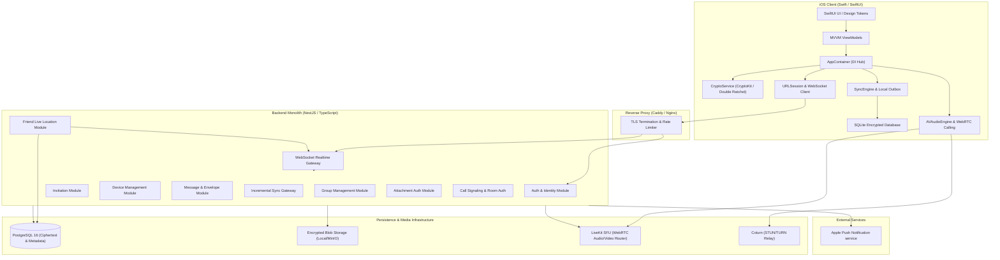

# Mini Telegram — Architecture Specification

## 1. System Overview

**Mini Telegram** is a private, invite-only, end-to-end encrypted team communication platform designed exclusively for iOS and backed by a self-hosted modular monolith backend. It is optimized for 10–50 team members, providing high security, zero external operational dependencies for core messaging, and complete data ownership.



---

## 2. iOS Client Architecture

### 2.1 Pattern and Separation of Concerns
- **Architecture Pattern**: MVVM (Model-View-ViewModel) + Clean Architecture with Dependency Injection (`AppContainer`).
- **Presentation Layer**: 100% SwiftUI with declarative state binding. View bodies remain purely declarative and contain zero business, cryptographic, or network logic.
- **Concurrency**: Swift Structured Concurrency (`async/await`, `Task`, `AsyncStream`, `Actor`).
- **Services (Actors & Protocol abstractions)**:
  - `CryptoServiceProtocol`: Handles X3DH identity generation, Double Ratchet sessions, key agreement, and symmetric message/file encryption. Isolated as a Swift `actor` to guarantee thread safety for ratchet state transitions.
  - `DatabaseServiceProtocol`: SQLite-backed persistent store for local envelopes, conversation caches, and persistent outbox queue.
  - `NetworkServiceProtocol`: High-performance HTTP client utilizing `URLSession` with automatic JWT refresh and request retries.
  - `WebSocketServiceProtocol`: Resilient duplex connection handling real-time push events, heartbeat pings, and delivery receipts.
  - `SyncEngineProtocol`: Outbox processor that drains pending sends with bounded exponential backoff and synchronizes missing server sequences upon reconnection.
  - `AudioVoiceServiceProtocol`: `AVAudioEngine` and `AVAudioRecorder` manager for voice messages, waveform extraction, and background playback.
  - `CallingServiceProtocol`: WebRTC and LiveKit client wrapper managing peer-connections, room tokens, audio session routing, and local/remote video feeds.
  - `LocalizationManager`: Centralized in-memory and persistent language controller allowing dynamic on-the-fly switching between English and Khmer (`km`).

### 2.2 Dependency Injection Container (`AppContainer`)
All services conform to protocols and are registered in a central, thread-safe `AppContainer`. This enables:
1. 100% deterministic unit testing via mock dependencies.
2. Clear separation between production keychain/cryptographic hardware and test harness.
3. Clean lifetime management across app foreground/background transitions.

---

## 3. Backend Architecture

### 3.1 Technology Stack & Structure
- **Framework**: NestJS (TypeScript, Node.js 24 LTS).
- **Architecture**: Modular Monolith organized by domain bounds (`auth`, `users`, `devices`, `invitations`, `conversations`, `messages`, `groups`, `attachments`, `calls`, `realtime`, `notifications`, `admin`).
- **API Style**: REST API versioned under `/api/v1` for mutations and bulk synchronization; authenticated WebSocket gateway for instant push notifications and signaling.
- **Database**: PostgreSQL 16 with schema migrations via structured SQL/TypeORM/Prisma migrations.
- **Friend live location**: the authenticated locations module retains only each sharing user's latest
  coordinate and an explicit per-session audience snapshot. Reads and WebSocket updates require both
  a selected viewer grant and a current mutual accepted friendship. Removing a friendship also
  removes its grant. Stopping sharing removes the coordinate and audience; no route history is
  collected. A separate stop-only capability supports revocation after the owner's login session
  expires without exposing location reads.
- **Relational Integrity**: Foreign keys with cascade constraints where safe; strict constraints on unique usernames, active device keys, and sequential message indices per conversation.

### 3.2 Authorization & Trust Boundary
- The backend operates strictly under an **Untrusted Message Relaying / Semi-Trusted Operational Model**:
  - The server is authoritative for: authentication, device membership, rate limiting, sequential message numbering, delivery state tracking, and attachment quota enforcement.
  - The server is **blind** to: message plaintext, attachment plaintext, voice recording plaintext, and media encryption keys.
  - All write mutations require a valid `Authorization: Bearer <access_token>` issued to a registered, non-revoked device.
  - WebSocket connections authenticate during the initial handshake and automatically disconnect upon session invalidation.

---

## 4. Media Infrastructure Architecture

### 4.1 Signaling & Transport
1. **One-to-One Calls**:
   - WebRTC peer-to-peer connection when direct connectivity is achievable.
   - LiveKit SFU routing fallback when both peers are behind symmetric NATs or network firewalls.
   - Signaling exchanged over secure WebSocket gateway via end-to-end authenticated payloads.
2. **Group Calls**:
   - Self-hosted LiveKit SFU (Selective Forwarding Unit).
   - Audio and video streams are routed as individual tracks; LiveKit forwards tracks without transcoding, ensuring minimal CPU load on the home server.
   - coturn deployed alongside LiveKit to provide STUN (NAT discovery) and TURN (UDP/TCP/TLS relay) services.

### 4.2 Call Encryption Pipeline
- Transport level: SRTP with DTLS handshake (standard WebRTC).
- Application level: LiveKit E2EE FrameCryptor (WebRTC Encoded Transform) utilizing AES-GCM-128/256 media encryption. Key distribution occurs through encrypted direct/group message channels before participant connection.

---

## 5. Storage Architecture

```
+-------------------------------------------------------------+
|                      Storage Hierarchy                      |
+-------------------------------------------------------------+
|  1. PostgreSQL 16 (Structured Metadata & Opaque Envelopes)  |
|     - User profiles, invitation tokens, hashed credentials  |
|     - Device public identity keys & one-time prekeys        |
|     - Encrypted message envelopes (opaque bytes)            |
|     - Monotonic sequence counters & sync cursors            |
|     - Call session logs & audit trail events                |
+-------------------------------------------------------------+
|  2. Encrypted Attachment Store (Local FS or MinIO S3)       |
|     - High-entropy ciphertext blobs                         |
|     - Strict byte quotas & content-type verification        |
|     - Short-lived signed authorization tokens for downloads |
+-------------------------------------------------------------+
|  3. iOS Local Client Storage                                |
|     - Apple Keychain (Device private keys, identity keys)   |
|     - SQLite encrypted cache (Decrypted messages & outbox)  |
|     - Local decrypted media cache (Protected sandbox)       |
+-------------------------------------------------------------+
```

---

## 6. Offline Synchronization & Data Consistency

1. **Transactional Sequence Allocation**:
   Every message submitted to a conversation is allocated a monotonic `sequence_id` via a PostgreSQL transaction:
   ```sql
   UPDATE conversations SET last_sequence_id = last_sequence_id + 1 WHERE id = $1 RETURNING last_sequence_id;
   ```
2. **Sync Cursors**:
   Clients persist `last_synced_sequence_id` per conversation. When reconnecting after an outage, the client queries:
   `GET /api/v1/conversations/{id}/messages?since_sequence={cursor}`.
3. **Local Outbox**:
   Messages written locally are stored in state `PENDING` with a client-generated UUID. They transition to `SENT` once acknowledged by the server. If the connection fails, the outbox retains the message and retries with jittered exponential backoff.
