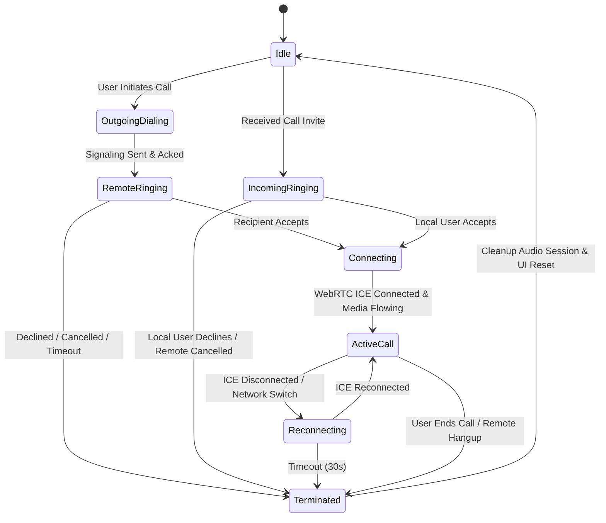

# Mini Telegram — Calling & Media Architecture (WebRTC / SFU)

## 1. Calling Subsystem Overview

Mini Telegram supports high-fidelity audio and video communications:
1. **One-to-One Calls**: Peer-to-peer WebRTC with STUN/TURN fallback, or relayed via LiveKit room.
2. **Group Meetings (Audio & Video)**: Routed through a self-hosted **LiveKit SFU** (Selective Forwarding Unit) with coturn providing NAT traversal.

---

## 2. Media Encryption & Confidentiality Analysis

### 2.1 Standard WebRTC Transport Encryption vs True E2EE
- **WebRTC Transport (DTLS-SRTP)**:
  - In standard WebRTC, all RTP packets are encrypted over the wire between the client and the SFU using DTLS-SRTP.
  - **Limitation**: The SFU terminates the DTLS-SRTP session to read packet headers and route RTP packets. Consequently, an untrusted SFU server could technically inspect or record media frames.
- **Application-Level End-to-End Encryption (FrameCryptor)**:
  - LiveKit Swift SDK (`client-sdk-swift`) includes native support for **WebRTC Encoded Transform (FrameCryptor)** using `BaseKeyProvider` and AES-GCM.
  - Media frames (audio Opus packets and video H.264/VP8 frames) are encrypted by the client *before* SRTP packaging.
  - The LiveKit SFU routes only opaque encrypted frame payloads and cannot decode the audio or video.
- **Key Distribution for Calls**:
  - The meeting encryption key is generated by the call initiator using a cryptographically secure 256-bit symmetric key.
  - This key is encrypted and distributed to invited participants via the **End-to-End Encrypted message/signaling channel** (Double Ratchet for 1-to-1, or Sender Keys for groups).
  - The media server receives only the LiveKit Room token with routing permissions, never the media frame encryption key.

### 2.2 Calling Encryption Classification:
- **Audio & Video Frames**: End-to-End Encrypted (when FrameCryptor is active).
- **Call Signaling Metadata**: Encrypted in transit via TLS to the backend, routed to authenticated group members.
- **Verification Gate**: Calls must indicate "Encrypted with FrameCryptor" only when the key exchange and crypto transform have succeeded.

---

## 3. WebRTC & LiveKit Infrastructure Configuration

### 3.1 Network Port Allocation & Firewall Rules
The self-hosted server must open and forward the following ports:

| Service | Port / Protocol | Direction | Purpose |
| :--- | :--- | :--- | :--- |
| **HTTP / HTTPS / WS** | `80, 443 TCP` | Inbound | API, WebSocket signaling, WebRTC webhooks |
| **LiveKit SFU Signal** | `7880 TCP` | Inbound (or proxied via 443) | LiveKit HTTP/WebSocket control channel |
| **LiveKit SFU Media** | `7881 TCP` | Inbound | LiveKit RTC TCP fallback |
| **LiveKit SFU UDP Media**| `50000–60000 UDP` | Inbound | WebRTC RTP/RTCP media streams |
| **Coturn STUN/TURN** | `3478 UDP/TCP` | Inbound | STUN binding & TURN UDP relay |
| **Coturn TURN over TLS**| `5349 UDP/TCP` | Inbound | Secure TURN TLS relay |
| **Coturn Relay Ports** | `49152–65535 UDP` | Inbound | TURN dynamic relay allocations |

---

## 4. iOS Audio & Video Engineering

### 4.1 Audio Session Management (`AVAudioSession`)
Audio configuration is handled through a dedicated `CallAudioManager`:
- **Mode**: `.voiceChat` or `.videoChat`
- **Category**: `.playAndRecord` with options:
  - `.allowBluetooth`
  - `.allowBluetoothA2DP`
  - `.defaultToSpeaker` (when video is enabled or hands-free selected)
- **Interruption Handling**: Listens to `AVAudioSession.interruptionNotification` (handles incoming phone calls, Siri interruptions, audio device disconnections).

### 4.2 Camera & Video Pipeline
- Input: `AVCaptureDevice` (Front / Rear toggling via LiveKit `CameraCapturer`).
- Rendering: Hardware-accelerated Metal rendering via LiveKit's `VideoView`.
- Resolution & Bitrate:
  - Adaptive resolution: 720p at 30 fps (default on Wi-Fi), dynamically scales down to 480p or 360p on constrained cellular networks.
  - Codec: H.264 (hardware encoder on Apple Silicon/A-series chips).

### 4.3 Simulator vs Physical Device Matrix

| Capability | iOS Simulator | Physical iPhone | Notes |
| :--- | :---: | :---: | :--- |
| **Call Signaling & Lifecycle** | ✅ Functional | ✅ Functional | Complete state machine, invite, ringing, accept, decline |
| **Audio Playback** | ✅ Functional | ✅ Functional | Routes to Mac audio output in simulator |
| **Audio Recording (Microphone)**| ⚠️ Host Mac mic | ✅ Functional | Requires macOS microphone permission |
| **Camera Video Capture** | ❌ Simulated video | ✅ Functional | Simulator produces synthetic test frames; physical camera required for real video |
| **Apple CallKit UI** | ⚠️ Partial | ✅ Functional | Simulator displays basic banner; system lockscreen UI requires physical device |
| **PushKit VoIP Notifications** | ❌ Unsupported | ✅ Functional | APNs VoIP tokens cannot be provisioned on simulator |
| **Cellular / Wi-Fi Handover** | ❌ Unsupported | ✅ Functional | Requires actual cellular radio |
