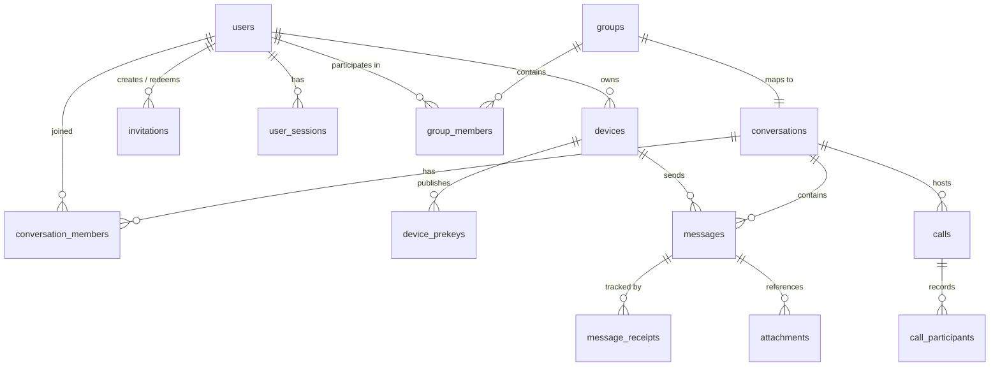

# Mini Telegram — Database Schema & Data Integrity Specification

## 1. Relational Model & Principles

The Mini Telegram database runs on **PostgreSQL 16**. It is architected for strict referential integrity, linear message sequence guarantees, zero plaintext leakage, and sub-millisecond query execution.

### 1.1 Core Entities & Schema Diagram



---

## 2. Table Specifications

### 2.1 `users`
Stores user identity metadata and account status.
```sql
CREATE TABLE users (
    id UUID PRIMARY KEY DEFAULT gen_random_uuid(),
    username VARCHAR(32) NOT NULL UNIQUE,
    display_name VARCHAR(64) NOT NULL,
    avatar_url VARCHAR(512),
    role VARCHAR(16) NOT NULL DEFAULT 'member' CHECK (role IN ('superadmin', 'member')),
    status VARCHAR(16) NOT NULL DEFAULT 'active' CHECK (status IN ('active', 'suspended', 'deactivated')),
    created_at TIMESTAMPTZ NOT NULL DEFAULT NOW(),
    updated_at TIMESTAMPTZ NOT NULL DEFAULT NOW()
);
CREATE INDEX idx_users_username ON users(username);
```

### 2.2 `invitations`
Controls all user registration. Open public registration is disabled.
```sql
CREATE TABLE invitations (
    id UUID PRIMARY KEY DEFAULT gen_random_uuid(),
    code VARCHAR(64) NOT NULL UNIQUE,
    created_by_user_id UUID NOT NULL REFERENCES users(id) ON DELETE CASCADE,
    used_by_user_id UUID REFERENCES users(id) ON DELETE SET NULL,
    role VARCHAR(16) NOT NULL DEFAULT 'member' CHECK (role IN ('superadmin', 'member')),
    expires_at TIMESTAMPTZ NOT NULL,
    revoked BOOLEAN NOT NULL DEFAULT FALSE,
    used_at TIMESTAMPTZ,
    created_at TIMESTAMPTZ NOT NULL DEFAULT NOW()
);
CREATE INDEX idx_invitations_code ON invitations(code);
```

### 2.3 `devices` & `device_prekeys`
Represents client installations and cryptographic prekeys for X3DH key agreement.
```sql
CREATE TABLE devices (
    id UUID PRIMARY KEY DEFAULT gen_random_uuid(),
    user_id UUID NOT NULL REFERENCES users(id) ON DELETE CASCADE,
    device_name VARCHAR(64) NOT NULL,
    platform VARCHAR(16) NOT NULL DEFAULT 'ios',
    identity_key_pub BYTEA NOT NULL,
    signed_prekey_pub BYTEA NOT NULL,
    signed_prekey_sig BYTEA NOT NULL,
    signed_prekey_id INTEGER NOT NULL,
    is_revoked BOOLEAN NOT NULL DEFAULT FALSE,
    revoked_at TIMESTAMPTZ,
    last_active_at TIMESTAMPTZ NOT NULL DEFAULT NOW(),
    created_at TIMESTAMPTZ NOT NULL DEFAULT NOW(),
    UNIQUE(user_id, identity_key_pub)
);
CREATE INDEX idx_devices_user ON devices(user_id);

CREATE TABLE device_prekeys (
    id UUID PRIMARY KEY DEFAULT gen_random_uuid(),
    device_id UUID NOT NULL REFERENCES devices(id) ON DELETE CASCADE,
    key_id INTEGER NOT NULL,
    public_key BYTEA NOT NULL,
    is_consumed BOOLEAN NOT NULL DEFAULT FALSE,
    consumed_at TIMESTAMPTZ,
    created_at TIMESTAMPTZ NOT NULL DEFAULT NOW(),
    UNIQUE(device_id, key_id)
);
CREATE INDEX idx_device_prekeys_available ON device_prekeys(device_id) WHERE is_consumed = FALSE;
```

### 2.4 `conversations`, `conversation_members` & `groups`
Unified representation for direct chats, private groups, and announcement channels.
```sql
CREATE TABLE conversations (
    id UUID PRIMARY KEY DEFAULT gen_random_uuid(),
    type VARCHAR(16) NOT NULL CHECK (type IN ('direct', 'group', 'channel')),
    title VARCHAR(128),
    avatar_url VARCHAR(512),
    created_by_user_id UUID REFERENCES users(id) ON DELETE SET NULL,
    last_sequence_id BIGINT NOT NULL DEFAULT 0,
    last_message_at TIMESTAMPTZ,
    created_at TIMESTAMPTZ NOT NULL DEFAULT NOW(),
    updated_at TIMESTAMPTZ NOT NULL DEFAULT NOW()
);

CREATE TABLE conversation_members (
    id UUID PRIMARY KEY DEFAULT gen_random_uuid(),
    conversation_id UUID NOT NULL REFERENCES conversations(id) ON DELETE CASCADE,
    user_id UUID NOT NULL REFERENCES users(id) ON DELETE CASCADE,
    role VARCHAR(16) NOT NULL DEFAULT 'member' CHECK (role IN ('owner', 'admin', 'member', 'read_only')),
    last_read_sequence_id BIGINT NOT NULL DEFAULT 0,
    is_pinned BOOLEAN NOT NULL DEFAULT FALSE,
    is_muted BOOLEAN NOT NULL DEFAULT FALSE,
    joined_at TIMESTAMPTZ NOT NULL DEFAULT NOW(),
    UNIQUE(conversation_id, user_id)
);
CREATE INDEX idx_conversation_members_user ON conversation_members(user_id);
```

### 2.5 `messages` & `message_receipts`
Encrypted envelopes with strictly ordered, monotonic sequence allocation.
```sql
CREATE TABLE messages (
    id UUID PRIMARY KEY, -- Client-generated UUID for idempotency
    conversation_id UUID NOT NULL REFERENCES conversations(id) ON DELETE CASCADE,
    sender_user_id UUID NOT NULL REFERENCES users(id) ON DELETE CASCADE,
    sender_device_id UUID NOT NULL REFERENCES devices(id) ON DELETE CASCADE,
    sequence_id BIGINT NOT NULL,
    envelope_type VARCHAR(16) NOT NULL DEFAULT 'e2ee_text' CHECK (envelope_type IN ('e2ee_text', 'e2ee_attachment', 'e2ee_voice', 'e2ee_call_signal', 'system')),
    encrypted_payload BYTEA NOT NULL, -- Opaque ciphertext (never plaintext)
    iv BYTEA NOT NULL,                -- AEAD Initialization Vector
    reply_to_message_id UUID REFERENCES messages(id) ON DELETE SET NULL,
    is_edited BOOLEAN NOT NULL DEFAULT FALSE,
    is_deleted BOOLEAN NOT NULL DEFAULT FALSE,
    created_at TIMESTAMPTZ NOT NULL DEFAULT NOW(),
    updated_at TIMESTAMPTZ NOT NULL DEFAULT NOW(),
    UNIQUE(conversation_id, sequence_id)
);
CREATE INDEX idx_messages_conv_seq ON messages(conversation_id, sequence_id ASC);

CREATE TABLE message_receipts (
    id UUID PRIMARY KEY DEFAULT gen_random_uuid(),
    message_id UUID NOT NULL REFERENCES messages(id) ON DELETE CASCADE,
    user_id UUID NOT NULL REFERENCES users(id) ON DELETE CASCADE,
    device_id UUID NOT NULL REFERENCES devices(id) ON DELETE CASCADE,
    status VARCHAR(16) NOT NULL CHECK (status IN ('delivered', 'read')),
    timestamp TIMESTAMPTZ NOT NULL DEFAULT NOW(),
    UNIQUE(message_id, device_id, status)
);
```

### 2.6 `attachments`
Metadata for encrypted binary blobs stored in file storage.
```sql
CREATE TABLE attachments (
    id UUID PRIMARY KEY DEFAULT gen_random_uuid(),
    message_id UUID REFERENCES messages(id) ON DELETE CASCADE,
    uploaded_by_user_id UUID NOT NULL REFERENCES users(id) ON DELETE CASCADE,
    byte_size BIGINT NOT NULL,
    sha256_checksum VARCHAR(64) NOT NULL,
    storage_path VARCHAR(512) NOT NULL,
    mime_type VARCHAR(128) NOT NULL,
    created_at TIMESTAMPTZ NOT NULL DEFAULT NOW()
);
CREATE INDEX idx_attachments_msg ON attachments(message_id);
```

### 2.7 `calls` & `call_participants`
Call session tracking and duration auditing.
```sql
CREATE TABLE calls (
    id UUID PRIMARY KEY DEFAULT gen_random_uuid(),
    conversation_id UUID NOT NULL REFERENCES conversations(id) ON DELETE CASCADE,
    initiated_by_user_id UUID NOT NULL REFERENCES users(id) ON DELETE CASCADE,
    call_type VARCHAR(16) NOT NULL CHECK (call_type IN ('audio', 'video')),
    status VARCHAR(16) NOT NULL DEFAULT 'dialing' CHECK (status IN ('dialing', 'active', 'ended', 'declined', 'missed')),
    livekit_room_name VARCHAR(128) NOT NULL UNIQUE,
    started_at TIMESTAMPTZ NOT NULL DEFAULT NOW(),
    ended_at TIMESTAMPTZ,
    duration_seconds INTEGER DEFAULT 0
);

CREATE TABLE call_participants (
    id UUID PRIMARY KEY DEFAULT gen_random_uuid(),
    call_id UUID NOT NULL REFERENCES calls(id) ON DELETE CASCADE,
    user_id UUID NOT NULL REFERENCES users(id) ON DELETE CASCADE,
    device_id UUID NOT NULL REFERENCES devices(id) ON DELETE CASCADE,
    status VARCHAR(16) NOT NULL DEFAULT 'invited' CHECK (status IN ('invited', 'ringing', 'joined', 'left', 'declined')),
    joined_at TIMESTAMPTZ,
    left_at TIMESTAMPTZ,
    UNIQUE(call_id, device_id)
);
```

### 2.8 `audit_events`
Security and administrative actions audit trail.
```sql
CREATE TABLE audit_events (
    id UUID PRIMARY KEY DEFAULT gen_random_uuid(),
    actor_user_id UUID REFERENCES users(id) ON DELETE SET NULL,
    action VARCHAR(64) NOT NULL,
    target_type VARCHAR(32) NOT NULL,
    target_id VARCHAR(64),
    metadata JSONB,
    ip_address VARCHAR(45),
    created_at TIMESTAMPTZ NOT NULL DEFAULT NOW()
);
CREATE INDEX idx_audit_created ON audit_events(created_at DESC);
```

---

## 3. Atomic Sequence Number Allocation

Message ordering inside a conversation is strictly linearized using PostgreSQL's row-level locking:
```sql
-- Allocate next monotonic sequence_id atomically
UPDATE conversations
SET last_sequence_id = last_sequence_id + 1,
    last_message_at = NOW(),
    updated_at = NOW()
WHERE id = $1
RETURNING last_sequence_id;
```
This guarantees no duplicate sequences, zero gaps under committed transactions, and total deterministic ordering across all clients.
