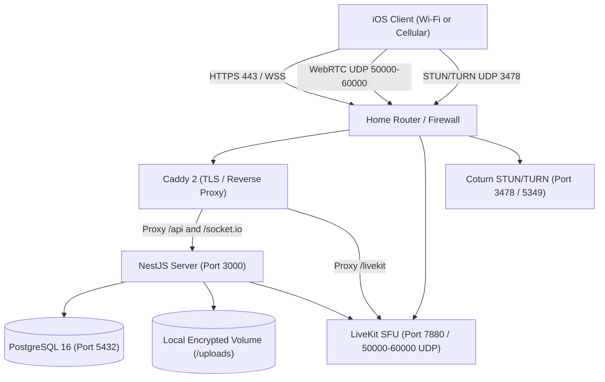

# Mini Telegram — Deployment & Self-Hosting Guide

## 1. Architecture & Service Topology

Mini Telegram is packaged for single-node or multi-container deployment using Docker Compose. All databases, caches, and storage backends run on an isolated private bridge network. Only reverse-proxy ports (80/443) and WebRTC media ports (UDP) are exposed to the host network.



---

## 2. Prerequisites & System Requirements

- **Operating System**: Linux (Ubuntu 22.04 LTS / 24.04 LTS, Debian 12) or macOS Apple Silicon.
- **Hardware Specs**:
  - Minimum: 2 CPU cores, 4 GB RAM, 30 GB SSD.
  - Recommended (for active video calls): 4 CPU cores, 8 GB RAM, 100 GB NVMe SSD.
- **Required Software**:
  - Docker Engine 24.0+
  - Docker Compose v2.20+
  - Git 2.30+

---

## 3. Step-by-Step Home Server Setup

### Step 3.1: Reserve a Static LAN IP
1. Log in to your home router administration panel (typically `http://192.168.1.1` or `http://192.168.0.1`).
2. Navigate to **DHCP Reservation** / **LAN IP Allocation**.
3. Locate the MAC address of your home server machine and bind it to a permanent static IP (e.g., `192.168.1.150`).

### Step 3.2: Verify Public IP & CGNAT Detection
To verify if your Internet Service Provider (ISP) uses Carrier-Grade NAT (CGNAT):
```bash
# Check WAN IP reported by your router or curl:
curl -s https://ifconfig.me
```
Compare this IP with the WAN IP displayed on your router's status page:
- **Direct Public IP**: Both match, and the IP does NOT fall in `100.64.0.0/10` or RFC 1918 private ranges (`10.x.x.x`, `172.16.x.x`, `192.168.x.x`). Port forwarding will function properly.
- **CGNAT Detected**: If the WAN IP is in `100.64.0.0/10` or differs from `ifconfig.me`, your ISP does not assign a public IPv4 address.
  - *Solution A (Zero-cost VPN Overlay)*: Use **Tailscale** or **Cloudflare Tunnel** to route traffic without opening router ports.
  - *Solution B ($3–$5/mo VPS Relay)*: Deploy coturn and Caddy on a cheap VPS (e.g. Hetzner, DigitalOcean) and reverse-tunnel to your home server over WireGuard.

### Step 3.3: Dynamic DNS (DDNS) Configuration
If your ISP assigns dynamic public IPs, configure a free DDNS hostname (e.g., DuckDNS, Cloudflare DNS with API token, or No-IP):
```bash
# Example DuckDNS cron check:
echo "url=https://www.duckdns.org/update?domains=my-minitelegram&token=YOUR_TOKEN&ip=" | curl -k -K -
```

### Step 3.4: Router Port Forwarding
Forward the following ports from your router to your server's static LAN IP (`192.168.1.150`):
- `80 TCP` -> `192.168.1.150:80` (HTTP ACME challenge)
- `443 TCP` -> `192.168.1.150:443` (HTTPS & WSS)
- `7880 TCP` -> `192.168.1.150:7880` (LiveKit signaling if not proxied)
- `50000-50100 UDP` -> `192.168.1.150:50000-50100` (LiveKit WebRTC Media)
- `3478 UDP/TCP` -> `192.168.1.150:3478` (STUN / TURN)
- `5349 UDP/TCP` -> `192.168.1.150:5349` (TURNS)

> **Important**: Never forward port 5432 (PostgreSQL) or internal application debug ports to the public internet!

---

## 4. Local Deployment Procedure

### 4.1 Clone and Configure
```bash
cd /path/to/mini-telegram
cp .env.example .env
# Edit .env and configure strong random secrets
```

### 4.2 Initialize Backend & Database
```bash
# Build and run using Docker Compose
docker compose -f infrastructure/docker-compose.yml up -d --build

# Verify all containers are healthy
docker compose -f infrastructure/docker-compose.yml ps
```

### 4.3 Automated Health Checks
The backend provides a comprehensive health check at:
`GET /api/v1/health`
Returns:
```json
{
  "status": "ok",
  "database": "connected",
  "storage": "writable",
  "uptime": 142.5
}
```

---

## 5. Maintenance, Backup & Disaster Recovery

See [`docs/BACKUP-RECOVERY.md`](file:///Users/macbook/NEW-GEN/docs/BACKUP-RECOVERY.md) for automated backup scripts, encrypted off-site archiving, and full disaster recovery runbooks.
