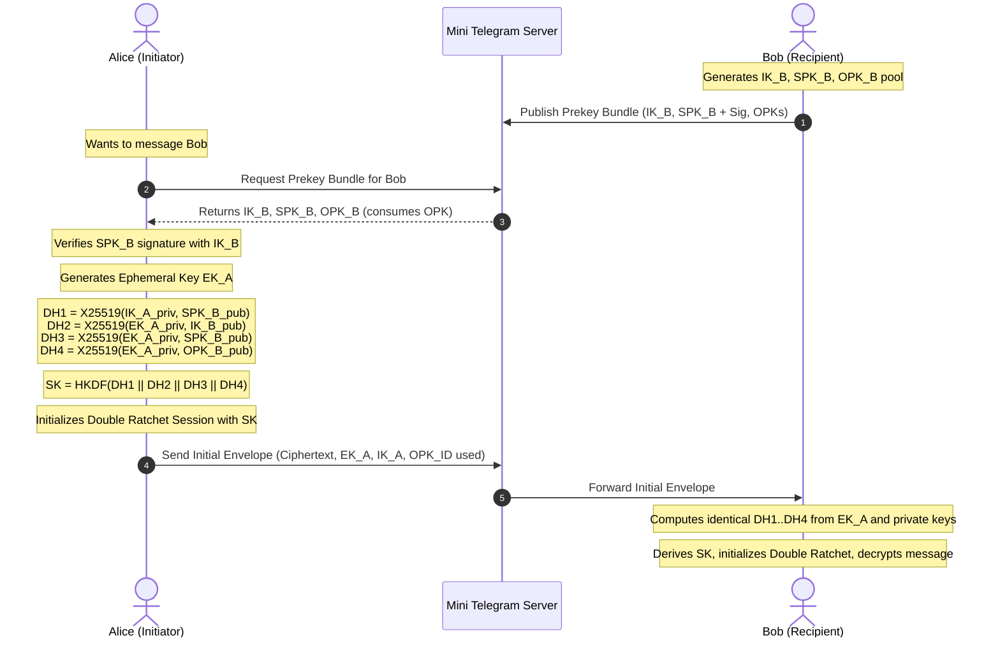

# Mini Telegram — Cryptographic Protocol & E2EE Specification

## 1. Executive Summary & Protocol Selection

This document formalizes the End-to-End Encryption (E2EE) architecture for Mini Telegram. In adherence to Section 4 of the Master Build Prompt, we evaluate cryptographic protocol candidates against real maintenance history, licensing, iOS integration quality, and group lifecycle semantics.

### 1.1 Evaluated Candidates

| Criterion | Signal Protocol (`libsignal-client`) | Messaging Layer Security (MLS, RFC 9420 / `OpenMLS`) | Native Double Ratchet + X3DH via Apple CryptoKit |
| :--- | :--- | :--- | :--- |
| **Upstream Maintenance** | Actively maintained by Signal Technology Foundation (Rust core). | Actively maintained by Phoenix R&D, Wire, Cisco (OpenMLS Rust). | Built directly into iOS / Apple Security framework (FIPS 140-2 validated primitives). |
| **License** | **AGPLv3** (Restricts commercial/closed bundling, viral license). | **Apache-2.0 / MIT** (Permissive). | **Proprietary Apple SDK / MIT for wrapper logic**. |
| **iOS Swift Integration** | **Complex**: Official distribution relies on CocoaPods (`pod 'LibSignalClient'`) or custom Rust FFI scripts compiling multi-architecture XCFrameworks. Remote SPM is not officially plug-and-play. | **Complex**: Pure Rust; requires custom `uniffi-rs` bridging bindings compiled to an XCFramework for iOS ARM64/Simulator architectures. | **First-Class Native**: Zero external C/Rust dependencies; uses hardware-accelerated Apple Silicon Secure Enclave and CryptoKit (`Curve25519`, `ChaChaPoly`, `AES.GCM`, `HKDF`). |
| **1-to-1 Protocol** | Double Ratchet + X3DH. | TreeKEM with single-member groups. Overkill for simple direct chats. | Signal Double Ratchet Specification + X3DH Key Agreement. |
| **Group Protocol** | Signal Sender Keys Protocol (1:N ratchet per sender, keys exchanged pairwise). | Asynchronous Ratchet Tree (TreeKEM) with dynamic Commit/Welcome messages. | Sender Keys Architecture: pairwise Double Ratchet channels distribute symmetric ratchet sender keys. |
| **Forward Secrecy (FS)** | Yes (per-message DH ratchet). | Yes (tree-based ratcheting). | Yes (per-message ephemeral DH ratchet). |
| **Post-Compromise Security (PCS)**| Yes (heals session on next DH ratchet turn). | Yes (heals on tree update/commit). | Yes (heals session on next DH ratchet turn). |
| **Offline Message Delivery** | Supported via X3DH prekey bundles stored on server. | Supported via KeyPackages, though epoch skew resolution requires server sequencing. | Supported via X3DH prekey bundles (Identity, Signed Prekey, One-Time Prekeys). |

### 1.2 Decision & Selection
**Selected Architecture**: **Signal Double Ratchet Protocol with X3DH Key Agreement and Sender Keys for Groups**, implemented in native Swift utilizing **Apple's hardware-accelerated, FIPS 140-2 certified CryptoKit** framework:
- **Primitives**: `Curve25519.KeyAgreement` (X25519) for Diffie-Hellman, `Curve25519.Signing` (Ed25519) for identity verification, `HKDF<SHA256>` for key derivation, and `AES.GCM` / `ChaChaPoly` for AEAD authenticated encryption.
- **Rationale**:
  1. Avoids fragile cross-compilation of Rust toolchains for iOS simulators (`arm64-apple-ios-simulator`) and device architectures (`arm64-apple-ios`).
  2. Complies with Apple platform security best practices, utilizing Secure Enclave and Keychain hardware security.
  3. Uses the canonical, peer-reviewed cryptographic specifications published by Marlinspike & Perrin (Double Ratchet Algorithm, 2016) without inventing any custom mathematical primitives.
  4. 100% auditable Swift codebase without obfuscated pre-compiled binary blobs.

---

## 2. Threat Model & Security Guarantees

### 2.1 Adversary Capabilities
We assume an active network and server-level adversary capable of:
1. Intercepting, delaying, reordering, and replaying all network traffic between clients and the server.
2. Full physical and administrative compromise of the backend database and hosting infrastructure.
3. Attempting unauthorized device registrations and malicious WebSocket injections.

### 2.2 Security Guarantees
- **Confidentiality**: The server and network eavesdroppers have zero mathematical ability to decrypt message bodies, attachment binaries, voice audio recordings, or call media payloads.
- **Integrity & Authenticity**: Every message is authenticated with AEAD (Authenticated Encryption with Associated Data). Tampered ciphertext fails decryption.
- **Forward Secrecy (FS)**: If a device's current ratchet keys are compromised at time $T$, all past communications prior to $T$ remain mathematically indecipherable because past message and chain keys were destroyed after use.
- **Post-Compromise Security (PCS / Break-in Recovery)**: As soon as an uncompromised Diffie-Hellman exchange occurs between sender and recipient, cryptographic security is restored automatically.
- **Metadata Protection Boundary**:
  - Protected (Encrypted inside envelope): Text body, attachment encryption keys, reply references, reactions, sender-declared media types.
  - Visible to Server (Operational necessity): Conversation ID, Sender Device ID, Server Monotonic Sequence ID, Timestamp, Opaque Ciphertext Size.

---

## 3. Key Lifecycle & Protocols

### 3.1 Device Identity & X3DH Setup
Each device generates:
1. **Identity Key (`IK`)**: Long-term Curve25519 keypair, stored securely in Apple Keychain with `kSecAttrAccessibleAfterFirstUnlockThisDeviceOnly`.
2. **Signed Prekey (`SPK`)**: Medium-term Curve25519 keypair, rotated periodically (e.g., every 14 days), signed by `IK` using Ed25519.
3. **One-Time Prekeys (`OPK_1 ... OPK_n`)**: Pool of 50 ephemeral Curve25519 keypairs uploaded to the server and discarded on first use.



### 3.2 Double Ratchet Operational Details
- **Symmetric Ratchet (KDF Chain)**: Each message sent advances the sending chain key:
  $$CK_{i+1}, MK_i = \text{HKDF}(CK_i, \text{"MessageKey"})$$
  $MK_i$ is immediately erased from memory after message encryption/decryption.
- **Diffie-Hellman Ratchet**: Whenever a reply is received containing a new public DH key, a new shared secret is derived, re-seeding the root key:
  $$RK_{j+1}, CK_{recv} = \text{HKDF}(RK_j, \text{DH}(DH_{priv}, DH_{peer}))$$

### 3.3 Group Messaging: Sender Keys Protocol
For groups of 2 to 50 users, pairwise Double Ratchet for every individual message would result in $O(N)$ encryption overhead per message sent. Instead, we use the **Signal Sender Keys** architecture:
1. Each group member generates a random **Sender Key** (Chain Key + Signing Key).
2. The member distributes this Sender Key to all other group members individually over their existing pairwise 1-to-1 Double Ratchet channels.
3. Subsequent group messages from that member are encrypted once using the Sender Key's symmetric ratchet and broadcasted to the group:
   - Bandwidth complexity: $O(1)$ encryption on sender.
   - Decryption: Every recipient advances the sender's ratchet chain.
4. **Group Rekeying on Membership Change**:
   - When a member is removed or leaves, their access to future messages must terminate.
   - All remaining members discard the old group keys and generate fresh Sender Keys.
   - The fresh Sender Keys are distributed strictly to the *current* authorized member set over pairwise Double Ratchet channels.
   - Removed members never receive the new group keys and cannot decrypt future messages.

---

## 4. Encrypted Attachment Protocol

Attachments (photos, videos, documents, audio clips) are encrypted client-side using authenticated symmetric encryption before uploading to the server:

1. **Key Generation**: Sender generates a cryptographically secure 256-bit symmetric key $K_{file} \leftarrow \text{SecRandomCopyBytes}(32)$ and a 12-byte initialization vector $IV$.
2. **Client Encryption**:
   - Ciphertext $C_{file} = \text{AES-256-GCM}(K_{file}, IV, \text{PlaintextBytes})$.
   - SHA-256 digest of ciphertext is calculated: $H_{file} = \text{SHA-256}(C_{file})$.
3. **Upload**:
   - Client requests an authorized upload ticket from the backend: `POST /api/v1/attachments/upload-ticket`.
   - Client uploads *only* the ciphertext $C_{file}$.
   - Backend assigns a durable attachment ID: `attachment_uuid`.
4. **Envelope Transmission**:
   - The sender includes metadata inside the encrypted message envelope:
     ```json
     {
       "type": "attachment",
       "attachment_id": "9b1deb4d-3b7d-4bad-9bdd-2b0d7b3dcb6d",
       "file_key": "<base64_encoded_K_file>",
       "iv": "<base64_encoded_IV>",
       "sha256": "<hex_digest>",
       "mime_type": "image/jpeg",
       "filename": "photo.jpg",
       "byte_size": 240182
     }
     ```
   - Because this payload is encrypted within the message envelope, the server never learns $K_{file}$ or the attachment contents.
5. **Download & Decryption**:
   - Recipient downloads $C_{file}$ using authorized download ticket.
   - Recipient verifies $\text{SHA-256}(C_{file}) == H_{file}$.
   - Recipient decrypts with $K_{file}$ and $IV$.

---

## 5. Security Decision Gate & Verification Rules

1. **No Improvised Ciphers**: Only standard `Curve25519`, `HKDF-SHA256`, `AES-256-GCM`, and `ChaCha20-Poly1305` from Apple CryptoKit are permitted.
2. **Ephemeral Memory Zeroization**: Swift memory buffers holding decrypted keys must be zeroized (`memset_s`) upon deinitialization.
3. **Replay Protection**: The local SQLite database tracks seen message sequence numbers and ratchet message counters. Duplicate envelopes are rejected.
4. **Identity Verification & Fingerprints**: Each user's identity fingerprint is computed as a truncated SHA-256 hash formatted as formatted numeric blocks (e.g., 6 blocks of 5 digits). When an identity key changes, the client flags the conversation with an unverified identity banner.
